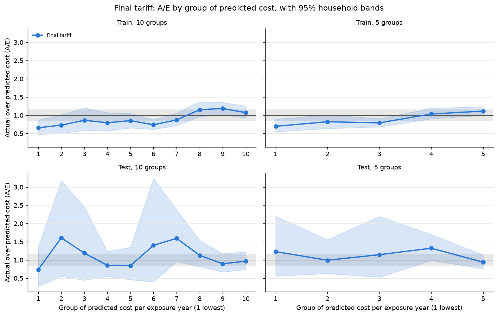
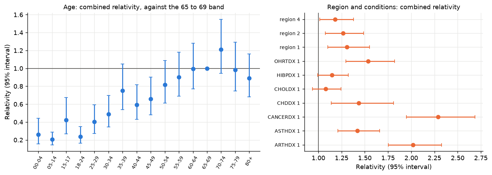
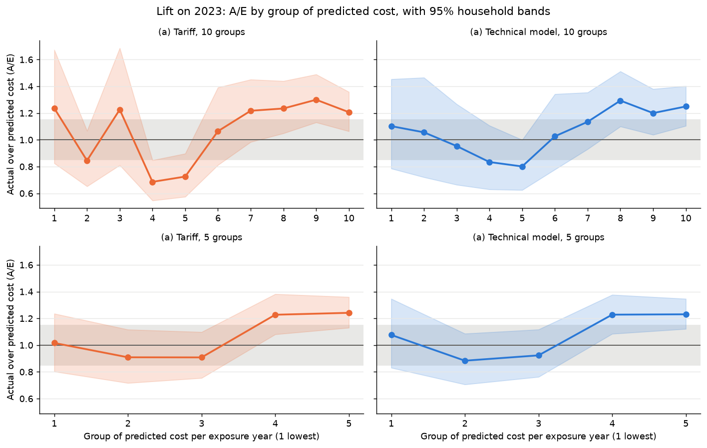
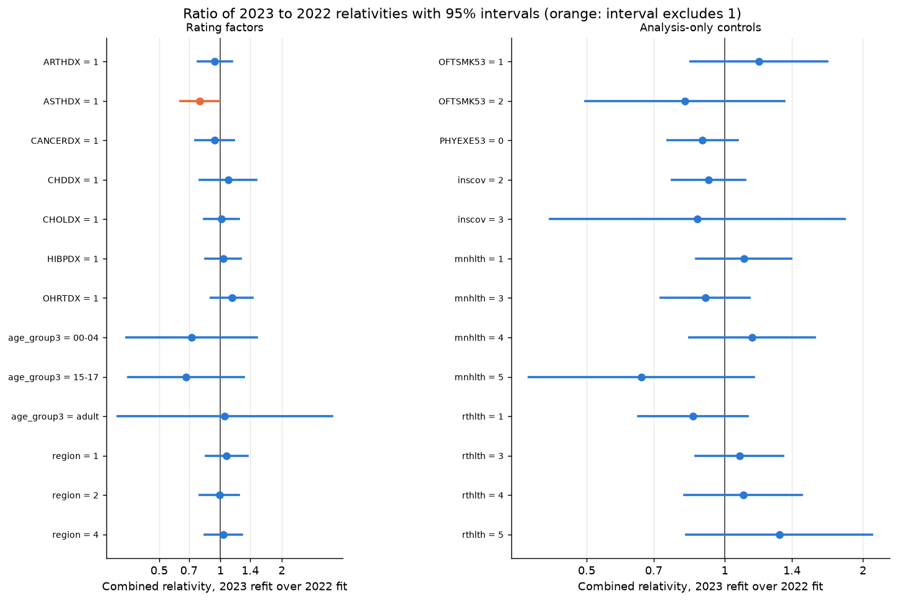
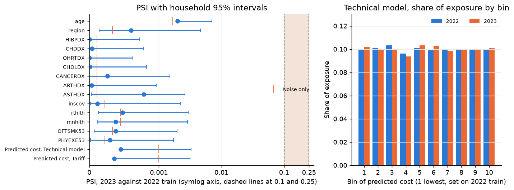
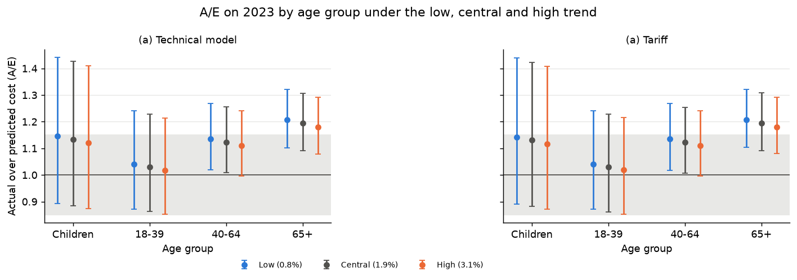

# UK-style health insurance pricing on MEPS: GLMs, out-of-time monitoring and a GBM challenger

## Key results

- **Final tariff.** 9 UK-permitted rating factors, a test deviance 9.7 percent below the baseline and a Gini of 0.378.
- **Out-of-time 2023.** A/E of 1.145, but the ranking, the relativities and the mix held, so it is a **level change and not a structure
  change**. A credibility-weighted rebase of 1.06.
- **v1 tariff and rating engine.** The final tariff adds a monotone adult age rule and a base rate at the rating-period level. The
  rating engine prices a profile with a factor-by-factor breakdown, and the contract tables are published in `outputs/v1/`.
- **GBM challenger.** LightGBM with cross-validation grouped by household did not beat the GLM, and SHAP found no missed
  interactions, so the **GLM tariff is the pricing basis**.
- **Judgement calls.** A smoker discount (a relativity of 0.60 for daily smokers) was found in the data, investigated and not priced.
  Exercise showed a raw 31 percent cost gap but no clear effect after adjustment (0.97 on frequency and 1.07 on severity).
- **Stack.** Python, SQL (DuckDB and dbt), statsmodels, LightGBM, SHAP and pytest.

A UK-style private medical insurance (PMI) pricing exercise built on US MEPS survey data. This is the **interim README**. The data
pipeline, the frequency and severity GLMs, the final tariff, the out-of-time test and monitoring on 2023 and the GBM challenger
(M4, lite) are done. The v1 tariff, the rating engine and the published contract tables (M6, lite) are also done. The Excel reconciliation and the model service are in progress (see
[Roadmap](#roadmap-in-progress)). The full plan is in [`_docs/plan.md`](_docs/plan.md), the decisions are in
[`_docs/decisions.md`](_docs/decisions.md) and the data flow is in [`_docs/data-flow.md`](_docs/data-flow.md).

The audience is an actuarial pricing reviewer. The full notebooks explain each step and are `03_glm.ipynb`, `04_monitoring.ipynb` and
`05_gbm.ipynb`. The short versions, which only load saved tables and charts, are
[`notebooks/03_glm_summary.ipynb`](notebooks/03_glm_summary.ipynb),
[`notebooks/04_monitoring_summary.ipynb`](notebooks/04_monitoring_summary.ipynb) and
[`notebooks/05_gbm_summary.ipynb`](notebooks/05_gbm_summary.ipynb). The v1 tariff and rating engine have their own short version,
[`notebooks/06_tariff_summary.ipynb`](notebooks/06_tariff_summary.ipynb), which loads `outputs/v1/`. Every number below is read from a saved table under `outputs/`.

## How this was built

This project was built with an AI coding agent working from a written spec, with decision gates where I made the modelling calls,
automated tests, a separate QA review of each task and a decision log. The agent does the implementation, and every modelling or data
choice is recorded with its evidence and alternatives. See [`AGENTS.md`](AGENTS.md), [`_docs/process.md`](_docs/process.md) and
[`_docs/decisions.md`](_docs/decisions.md).

## The problem

A UK private medical insurer prices each policy from a base rate and a small set of rating factors. This project builds that
rating structure from claims data, tests it on a later year, and monitors it as a pricing team would: actual against expected cost
(A/E), stability of the relativities, drift in the mix of people, and a rule for when to change the level or the structure.

## The data and the UK framing

The data are the Medical Expenditure Panel Survey (MEPS) of the US Agency for Healthcare Research and Quality (AHRQ): the 2022 and
2023 full-year consolidated files and the event files for inpatient stays, outpatient visits and office-based visits. There is no
UK claims data of this kind in the public domain, so MEPS is used to show the method.

- **Claims.** A claim is a PMI-scope event: stays and visits that a UK private medical policy would normally pay for, with
  stays that began in the emergency room left out of the base definition. See [`_docs/pmi-scope.md`](_docs/pmi-scope.md).
- **Time.** 2022 is the modelling year, split by household into a training and a test split. 2023 is the out-of-time year. 2022 costs
  are on-levelled to 2023 prices with the PCE-Health index.
- **Rating factors.** The final structure uses only factors a UK insurer could use. Sex, race, income and education are excluded.
- **People.** The modelling table has one row per person-year (40,210 in all), with exposure in years.

Raw MEPS files and person-level data are not in the repository. Published outputs are aggregates only. MEPS data are used for
statistical analysis and reporting only, with no attempt to identify individuals. Source: AHRQ / MEPS, https://meps.ahrq.gov.



## Method

**Two-part model.** Expected annual cost is the chance of a claim times the expected cost of a claimant. The chosen model, (a), has a
binomial frequency part with a complementary log-log link and an offset of log exposure, and a Gamma severity part with a log link.
Candidate (b) has a Poisson frequency part, which makes it exactly multiplicative, and candidate (c) is stacked by benefit type. Both
were close to (a) on the test split and were not chosen. The models are compared on the 2022 test split with the Tweedie deviance
(power 1.5), the exposure-weighted Gini, lift and double-lift charts and A/E. The full table of every candidate is in
[`notebooks/03_glm_summary.ipynb`](notebooks/03_glm_summary.ipynb).

| Model | Frequency part | Severity part | Expected annual cost | Multiplicative | Parameters |
|---|---|---|---|---|---|
| (a) Binomial-cloglog × Gamma | Binomial, cloglog, offset $\log t_i$ | Gamma, log | $p_i\,\mu_i\,(1+\ell)$ | No, the claim chance cannot exceed 1 | 88 |
| (a) Final structure with a smooth age curve | Binomial, cloglog, age spline | Gamma, log, age spline | $\rho\,p_i\,\mu_i\,(1+\ell)$ | No | 64 |
| (a) Final tariff | None, a Poisson-log model of the smooth age model's cost | None | $t_i\,r_0\prod_k r_{k,\,l_k(i)}$ | Yes | 26 |

The first row has all 18 candidate factors and the other two have the 9 rating factors and 5 analysis-only controls. A parameter is a
coefficient of the frequency part plus a coefficient of the severity part, and the dispersion is not counted. Here $t_i$ is the
exposure of person-year $i$ in years, $p_i$ is its chance of a claim, $\mu_i$ is the expected cost of a claimant, $\ell$ is the
provisional large-claim load, $\rho$ is the balance factor that makes predicted cost equal actual cost on 2022 train, $r_0$ is the base
rate per year of exposure, $l_k(i)$ is the level of rating factor $k$ for person-year $i$ and $r_{k,l}$ is the relativity of level $l$
of factor $k$.

**Large claims.** Annual cost per person-year is capped at 100,000 dollars when fitting. In train, 32 claimants are above the cap and
6.1 percent of train cost is above it. A flat provisional load of 6.5 percent adds it back. Costs are scored uncapped. The load is
re-estimated in M6.

**Factors.** The final structure has 9 rating factors: age, region and seven condition flags (high blood pressure, coronary heart
disease, other heart disease, cholesterol, cancer, arthritis and asthma). Four condition flags were dropped by a selection rule.
Self-rated health, mental health, exercise, insurance coverage (`inscov`) and smoking are fitted as controls and priced at their
reference level, so they are analysis-only. Smoking has a relativity of 0.60 for daily smokers, which is not
a causal effect, so no smoker discount is applied. Removing the condition flags barely moves it (0.60), so the flags do not explain it,
and the pattern is consistent with US differences in access to and use of care. Adult age is a smooth curve (a natural spline) and the tariff reads
five-year bands off it. The condition flags stand in for the health information a UK insurer would collect at underwriting.

**Final tariff.** A multiplicative model with 26 parameters, fitted to the predictions of the smooth model, so
that relativities multiply as a rating table does. On the 2022 test split its deviance is 838,173 (9.7 percent below the baseline), its Gini is
0.378 and its A/E is 1.081. The technical model (the unrounded structure) is what the out-of-time test scores
alongside it.

## Results

### Models on the 2022 test split

- Candidate (a) with all factors has a test deviance of 808,193 (12.9 percent below the baseline) and a Gini of 0.433.
  Candidate (b) is close, with a deviance of 816,054 (12.1 percent below the baseline). The surrogate model (tariff)
  of (a) has 814,292 (12.3 percent below the baseline), so the multiplicative form costs little.
- The final structure with 9 factors has a deviance of 830,232 (10.6 percent below the baseline) and a Gini of 0.393.





### Out-of-time test on 2023

The model is frozen on 2022 and scored on 2023, which no earlier step used. The forecast trend is the CMS Unified Rate Review median
utilization trend of 1.9 percent, set before looking at 2023.

| Question | Result |
|---|---|
| A/E, technical model | 1.145 (1.075 to 1.220) |
| A/E, tariff | 1.145 (1.074 to 1.220) |
| Gini, technical model and tariff | 0.473 and 0.468 |
| Rise in cost per exposure year | 16.9 percent, of which severity beyond the price index 13.9 percent (5.6 to 23.0) |
| Relativities stable? | Wald test p of 0.64 (frequency) and 0.27 (severity), 1 of 13 rating levels beyond noise |
| Mix of people moved? | Largest PSI 0.0020, far below 0.1 |
| Rebase | 1.06 on the forecast cost, with bounds of 1.025 and 1.145 |
| Trend sensitivity | A/E of 1.158 and 1.132 at the low and high trend, the same action |
| ER-originated stays added | Cost rises by 33.0 percent, A/E of 1.523 for the base model and 1.147 for the refit on the broadened cost |

The Gini on 2023 and on the 2022 test split are not directly comparable, because they come from different people and years. The
ranking holds on 2023 and the relativities and the mix do not move, so the gap is a **change of level and not of structure**.
It is mostly severity beyond the price index, read as intensity. The recalibration rule recommends a rebase, and the factor of 1.06
weights one noisy year of own experience (+14.5 percent) with an external level change (+2.5 percent). The M6 pooled refit with a
year term estimates the level directly and supersedes it. People with a diagnosed condition were under-predicted by more than the
book, which is a pattern to watch. The rule is in [`_docs/recalibration-rule.md`](_docs/recalibration-rule.md).









How the evidence is produced and read:





### Gradient-boosting challenger (M4-lite)

A LightGBM model with a Tweedie objective, log exposure as an offset and five-fold cross-validation grouped by household did not beat
the GLM on the 2022 holdout. Its test deviance is 840,754 against 838,173 for the GLM tariff and 831,786 for the technical model, with
a Gini of 0.378 for both the GBM and the GLM tariff (0.386 for the technical model), and the gaps are within noise. Its surrogate
tariff is worse than the GLM tariff, with a deviance of 843,827 and a Gini of 0.368. SHAP found no interaction among the rating factors
that the GLM misses. On 2023 the Gini is 0.469 for the GBM, 0.460 for its tariff and 0.468 for the GLM tariff, and the GBM deviance is
0.6 percent below the GLM tariff's but its own tariff is above it. The GBM is constrained to rise with adult age, as UK premiums do,
and a diagnostic refit without the constraint was no better (deviance 843,561, Gini 0.372). **The GLM tariff is the pricing basis.**
The short version is [`notebooks/05_gbm_summary.ipynb`](notebooks/05_gbm_summary.ipynb) and the full one is `notebooks/05_gbm.ipynb`.

## The v1 tariff, rating engine and published tables (M6, lite)

The v1 tariff is the 2022-fitted multiplicative tariff of M3 with two changes. The adult age relativities follow a monotone rule (an
isotonic adjustment that pools the bands from 60-64 to 80+), and the base rate carries the forecast trend of 1.019 and the rebase of
1.06 (1.080 together). On the 2022 test split the tariff has a deviance of 839,170 and a Gini of 0.376, and on grouped
cross-validation the rule lowers the out-of-fold deviance by 0.07 percent. On 2023 the A/E is 1.080 after the rating-period level.
The rebase is a credibility-weighted judgement, so it does not bring the 2023 A/E to 1.00.

The rating engine, `health_pricing.rating.rate(profile, "v1")`, returns the premium and its breakdown from the published tables. It
rejects sex, race, income and education and prices the analysis-only controls at their reference level. Premiums are dollars per
exposure-year, with a **risk premium (expected claims cost), illustrative pounds** alongside, excluding expenses and margin (see
Limitations). The golden test cases in `outputs/v1/golden_cases.csv` are a **regression baseline, provisional until M7**, because the
Excel reconciliation will replace them.

`outputs/v1/` holds `model_version.json`, `relativities.csv`, `base_rate.csv`, `scaling.json`, `ae_table.csv`, `psi_table.csv`,
`in_force_book.csv`, `golden_cases.csv` and an example scenario with its dislocation histogram. They are aggregated tables only. A
contract test (`tests/test_contract_v1.py`) checks the files, the schemas, the totals and each golden premium. Rebuild them with
`uv run python -m health_pricing.publish`. In the example scenario (base +4 percent, +5 percent on 75-79 and +10 percent on 80+, cap
+12 percent) total premium rises 5.4 percent and the cap gives up about 0.3 percent of premium.

## ML Zoomcamp: the pricing service (M10-lite)

**Problem.** A pricing team needs to quote a customer, read the relativities, check the monitoring tables and test a rate change without
running the modelling code. The service answers those four questions over HTTP, from the published tables in `outputs/v1/` and the
rating engine. It holds no model object. Premiums are dollars per exposure-year, with a **risk premium (expected claims cost),
illustrative pounds** alongside, excluding expenses and margin.

**Train.** `uv run python train.py` rebuilds `outputs/v1/` from the MEPS data (see
[Reproduce from a clean clone](#reproduce-from-a-clean-clone) for the download, load and dbt steps) and saves the OpenAPI schema to
[`_docs/openapi.json`](_docs/openapi.json). `uv run python predict.py --age 40 --region 3 --CANCERDX 1` prices one profile from the
command line.

**Run.**

```
uv run uvicorn health_pricing.service.app:app --port 8000
```

The endpoints are `GET /health`, `POST /quote`, `GET /relativities`, `GET /monitoring` and `POST /scenario-impact`. The interactive
documentation is at `http://localhost:8000/docs`.

**Call.**

```
curl -s -X POST http://localhost:8000/quote -H "Content-Type: application/json"   -d '{"age":40,"region":"3","HIBPDX":"0","CHDDX":"0","OHRTDX":"0","CHOLDX":"0","CANCERDX":"1","ARTHDX":"0","ASTHDX":"0"}'

curl -s -X POST http://localhost:8000/scenario-impact -H "Content-Type: application/json"   -d '{"base_change":0.04,"relativity_changes":[{"factor":"age","level":"80+","change":0.1}],"cap":0.12,"floor":0.0}'
```

A profile with a factor that is not permitted (sex, race, income or education) or a level that does not exist returns a 422 with the
reason. Smoking, health and exercise answers are accepted and priced at their reference level.

**Docker.** The image holds only the service code and `outputs/v1/`. It needs no MEPS data and runs as a non-root user.

```
docker build -t health-pricing-service:v1 .
docker run --rm -p 8000:8000 health-pricing-service:v1
```

The image is to be published to the GitHub Container Registry as `ghcr.io/asudarmo/health-pricing-meps:v1`. The push has not been
done yet (issue #67), so build the image locally for now.

**Tests.** `uv run pytest tests/test_service.py` starts the service and checks that `/quote` returns the premium of every golden case.
Set `SERVICE_URL=http://localhost:8000` to run the same checks against a running container. The golden cases are a regression baseline,
provisional until the Excel reconciliation (M7).

**Relation to the AI Dev Tools app.** The app is a separate repository for the AI Dev Tools capstone. It calls this service over HTTP and
does not import the package. The course instructor confirmed in the ML Zoomcamp Slack on 2 November 2026 that the app may consume this
service. This repository is the ML Zoomcamp midterm.

**Cloud deployment (not yet deployed).** The service has not been deployed. To run it on Google Cloud Run, with a Google Cloud
project and the `gcloud` CLI installed, run these commands from the repository root.

```
gcloud auth login
gcloud config set project PROJECT_ID
gcloud services enable run.googleapis.com cloudbuild.googleapis.com artifactregistry.googleapis.com
gcloud run deploy health-pricing --source . --region europe-west2 --port 8000 --allow-unauthenticated
```

Cloud Run builds the image from the `Dockerfile` and prints the service URL. Replace `http://localhost:8000` in the calls above with that
URL. Drop `--allow-unauthenticated` to require a Google identity token.

## Limitations

- **US data.** MEPS is a US survey. Costs, benefit design and the mix of people differ from a UK book, so the results show the
  method and not UK prices.
- **Small, heavy-tailed samples.** The 2022 test split and the 2023 year are small with a heavy tail, so intervals are wide and
  level-by-level A/E flags are noted and not tuned.
- **Provisional large-claim load.** The load of 6.5 percent is from 2022 train and is not tuned to 2023. It is re-estimated in M6.
- **Conditions stand in for underwriting.** The condition flags are a proxy for underwriting information, and the A/E by level
  shows a pattern for them that is worth watching.
- **Smoking.** Smoking is analysis-only and no discount or loading is applied.
- **Older ages.** The tariff's age curve flattens after about 60 and falls from the 65-69 band (the 80+ relativity is 0.887 against
  1.000 at 65-69). One likely reason is that the PMI scope leaves out stays that began in the emergency room, which are concentrated at
  older ages (they add 39.0 percent to cost at 65 and over against 24.8 percent at 18 to 39). The ER sensitivity points the same way
  but does not settle it. With the stays added, the age curve is higher at old ages (the relativity at 80 against 67 is 0.983 against
  0.870 and at 85 it is 0.947 against 0.782), yet the interval of the ratio contains 1 at every age. A UK implementation would
  calibrate older-age relativities to UK market experience. The v1 tariff applies a monotone adult age rule (issue #57), which pools
  the bands from 60-64 to 80+ so that adult relativities never fall. This puts the 80+ tariff 8.2 percent above the technical model on
  the 2022 test split. The likely cause is the exclusion of ER-originated stays, concentrated at older ages, which pulls the model's
  own older-age curve down. This cause is not tested beyond the ER sensitivity above.
- **Illustrative pounds.** Premiums in pounds are a risk premium (expected claims cost), illustrative, and exclude expenses and margin.
  The scaling of 0.244 pounds per dollar sets the model mean (2,358 dollars per exposure-year) equal to the UK claims cost per
  covered life of 576 pounds (ABI, published 6 November 2024, 2023 data: 3.57 billion pounds of claims and 6.2 million people
  covered). It includes the exchange rate and is not a UK price.
- **The trend is an assumption.** The 1.9 percent is an external utilization trend from insurers' rate filings. The A/E and the rebase are
  shown at a low and a high trend.
- **One out-of-time year.** A one-off change in level cannot be separated from a lasting one with one year of data.

## Roadmap (in progress)

| Milestone | What it will add | Reruns |
|---|---|---|
| M4 Pure premium and ML challenger | Done (lite): the LightGBM challenger with SHAP, grouped cross-validation and its surrogate tariff, with the GLM tariff kept as the pricing basis. A Tweedie GLM and a GBM with the health and exercise controls are optional and not run | Nothing, because M4 did not change the chosen model |
| M6 Final model, rating engine and rate change | Done (v1-lite): the monotone adult age rule, the final tariff with the 1.06 rebase, the rating engine, the in-force book, scenario impact and the published `outputs/v1/` (drafts in `outputs/m6_draft/`). Deferred to v2: a pooled refit with a year term, a re-estimated large-claim load and indexed cap, and a projection to the rating period | The v2 refit supersedes the 1.06 rebase |
| M7 Excel reconciliation | A small Excel rating workbook that Python reproduces to the penny, with golden test cases | |
| M10 Model serving | Done (lite, not deployed): `train.py`, `predict.py`, a FastAPI service for quotes, relativities, monitoring and scenario impact, the saved OpenAPI schema and a Docker image. Cloud deployment is not done | |

## Reproduce from a clean clone

The raw files are downloaded by script and are not committed.

```
uv sync
uv run python -m health_pricing.data.download
uv run python -m health_pricing.data.load
uv run dbt deps --project-dir dbt --profiles-dir dbt
uv run dbt build --project-dir dbt --profiles-dir dbt
uv run pytest
uv run python -m health_pricing.data.urr
uv run python -m health_pricing.diagrams
uv run jupyter lab
```

Open the notebooks in order: `01_data.ipynb`, `02_eda.ipynb`, `03_glm.ipynb`, `04_monitoring.ipynb` and `05_gbm.ipynb`. The summary
notebooks `03_glm_summary.ipynb`, `04_monitoring_summary.ipynb`, `05_gbm_summary.ipynb` and `06_tariff_summary.ipynb` only read saved tables and charts. Seeds are fixed, so the results reproduce.

## Licence note

MEPS data is used for statistical analysis and reporting only, with no attempt to identify individuals. Source: AHRQ / MEPS,
https://meps.ahrq.gov.
