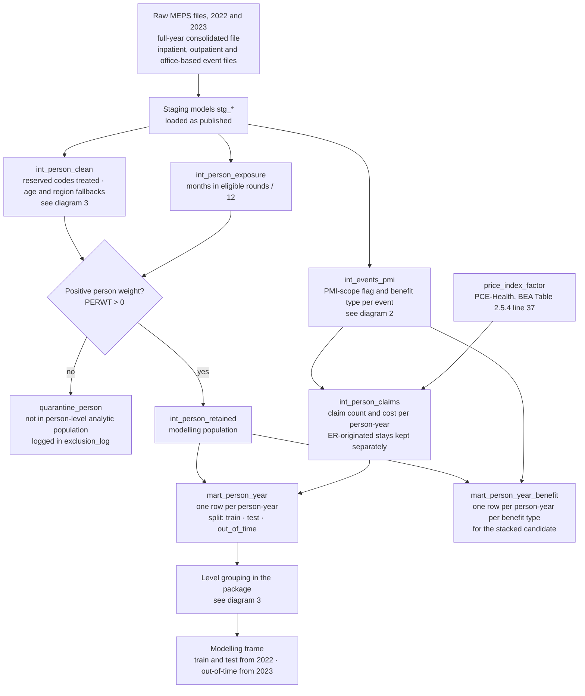
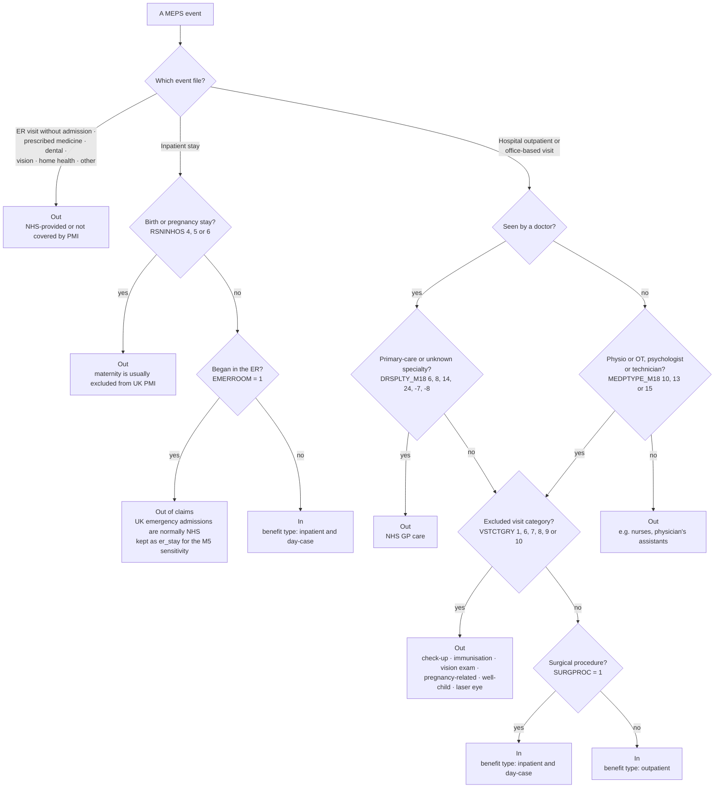
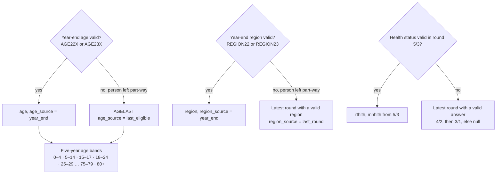
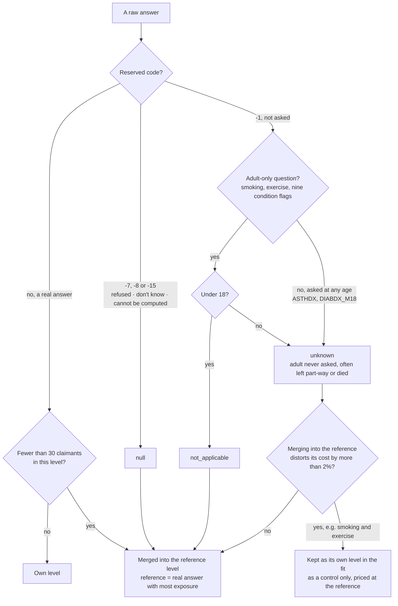

# Data flow and decision rules

Three diagrams show how raw MEPS data becomes the modelling frame, and how the UK PMI framing is applied.
Each step names the `decisions.md` entry behind it. The diagrams show structure only. Counts of persons,
events and cost at each step are in the generated table at the end, so the numbers cannot drift from the
data.

## 1. Pipeline from raw MEPS files to the modelling frame

| Step | Decision log entry |
|---|---|
| Variable shortlist and mapping | 2026-10-31 MEPS variable shortlist and 2022-23 mapping (gate 1) |
| Reserved codes and age fallback | 2026-11-01 Reserved-code treatment (issue #12) |
| Region fallback and `left_survey_early` | 2026-11-01 Region for people who left part-way |
| Exposure | 2026-11-01 Exposure derivation (issue #13) |
| Modelling population | 2026-11-01 Modelling population and exclusions (gate 3) |
| PMI-scope claims | 2026-11-01 PMI-scope claim definition (gate 2) |
| On-levelling to 2023 prices | 2026-11-01 Price index for on-levelling (gate 4) and PMI-scope claim counts (issues #15, #16) |
| Train, test and out-of-time split | 2026-11-01 Household-grouped split within 2022 (issue #18) |
| Benefit types | 2026-11-02 Benefit types for the stacked candidate (issue #24) |
| Level grouping | Gate 6 (2026-11-02) |

## 2. Is an event a PMI-scope claim?

This is the UK framing. MEPS records all care. UK PMI pays only for part of it, because the NHS provides
the rest.

Psychiatry (specialty 28) and psychologist visits are in, including psychotherapy (visit category 4).
Session limits belong to the product layer, not the claim definition.

Known limitation: real UK PMI also excludes cover by condition (chronic conditions, and pre-existing
conditions under a moratorium). MEPS cannot model this cleanly, so the scope is defined by event type,
provider and visit category only.

## 3. How a raw value becomes a modelling level

### 3a. Person characteristics with fallbacks

### 3b. Answer levels for smoking, exercise and condition flags

The `unknown` level is checked for leakage because it largely marks people who left the survey, often by
dying. An insurer cannot know this when pricing, so it is never priced as a rating factor.
`left_survey_early` is kept for analysis only and is never a rating factor.

## 4. Counts at each step

Generated, do not edit by hand. To be produced from `exclusion_log`, `int_events_pmi`, `int_person_claims`
and `mart_person_year`: persons, events and cost (nominal and at 2023 prices) for each year at each step
of diagrams 1 and 2.
